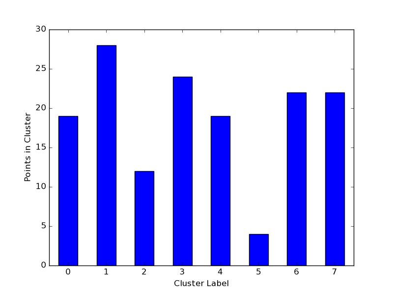
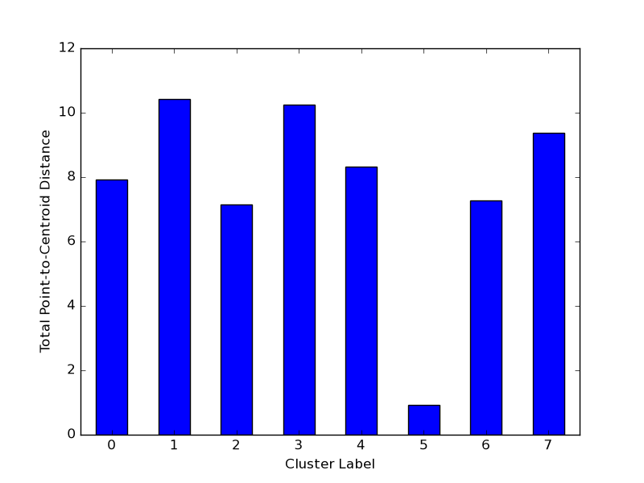
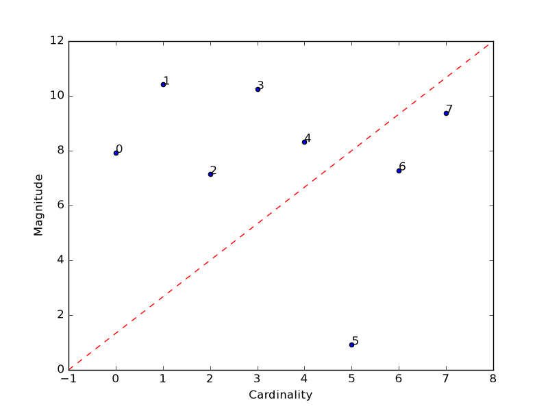

************************
Plot Cluster Cardinality
************************

The plot_cluster_cardinality function visualizes the number of points in each cluster, which can help identify imbalanced clusters or outliers.

.. autofunction:: ds_utils.unsupervised.cluster_diagnostics.plot_cluster_cardinality

.. highlight:: python

In the following example, we'll use the iris dataset from scikit-learn and create a simple K-Means algorithm with k=8 to plot how many points go to each cluster::

    from matplotlib import pyplot as plt
    from sklearn.cluster import KMeans
    from ds_utils.unsupervised.cluster_diagnostics import plot_cluster_cardinality

    # Create and fit the K-Means model
    estimator = KMeans(n_clusters=8, random_state=42)
    estimator.fit(X)

    # Plot the cluster cardinality
    plot_cluster_cardinality(estimator.labels_)
    plt.show()

And the following image will be shown:

**********************
Plot Cluster Magnitude
**********************

The plot_cluster_magnitude function visualizes the total point-to-centroid distance for each cluster, which can help
identify compact or dispersed clusters.

.. autofunction:: ds_utils.unsupervised.cluster_diagnostics.plot_cluster_magnitude

Here's an example of how to use the plot_cluster_magnitude function::

    from matplotlib import pyplot as plt
    from sklearn.cluster import KMeans
    from scipy.spatial.distance import euclidean
    from ds_utils.unsupervised.cluster_diagnostics import plot_cluster_magnitude

    # Create and fit the K-Means model
    estimator = KMeans(n_clusters=8, random_state=42)
    estimator.fit(X)

    #Plot the cluster magnitude
    plot_cluster_magnitude(X, estimator.labels_, estimator.cluster_centers_, euclidean)
    plt.show()

And the following image will be shown:

*************************
Magnitude vs. Cardinality
*************************

The plot_magnitude_vs_cardinality function creates a scatter plot of cluster magnitude against cardinality, which can help identify anomalous clusters.

.. autofunction:: ds_utils.unsupervised.cluster_diagnostics.plot_magnitude_vs_cardinality

Here's how to use the plot_magnitude_vs_cardinality function::

    from matplotlib import pyplot as plt
    from sklearn.cluster import KMeans
    from scipy.spatial.distance import euclidean
    from ds_utils.unsupervised.cluster_diagnostics import plot_magnitude_vs_cardinality

    # Create and fit the K-Means model
    estimator = KMeans(n_clusters=8, random_state=42)
    estimator.fit(X)

    # Plot magnitude vs. cardinality
    plot_magnitude_vs_cardinality(X, estimator.labels_, estimator.cluster_centers_, euclidean)
    plt.show()

And the following image will be shown:

