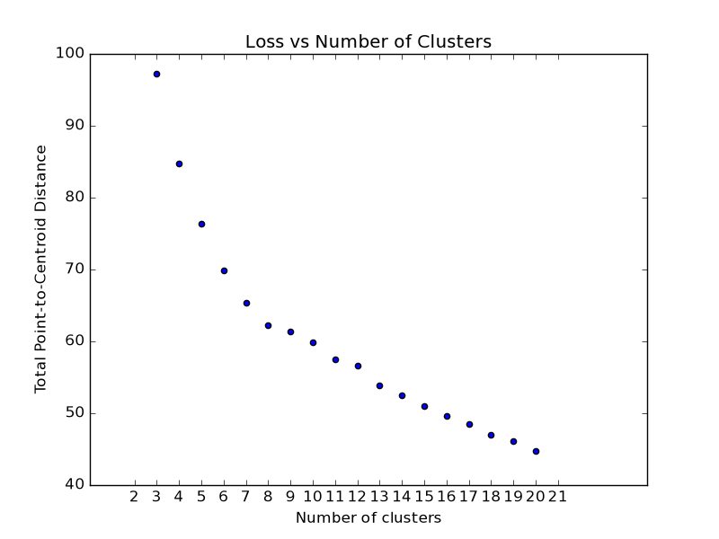
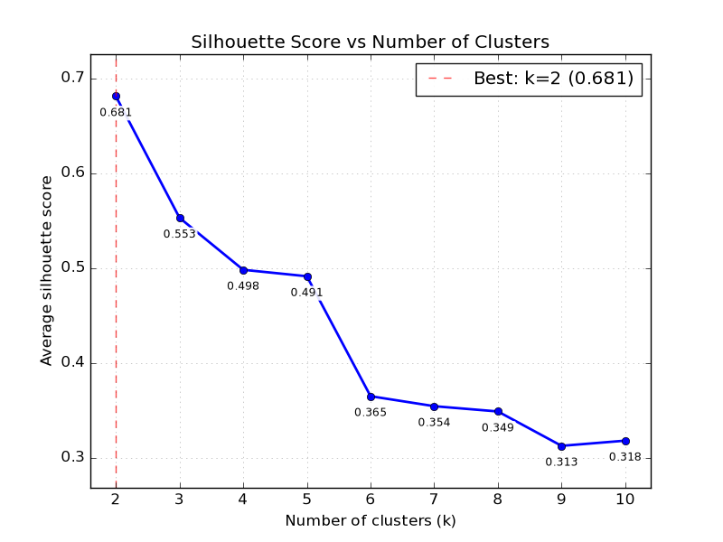

**************************
Optimum Number of Clusters
**************************
The plot_loss_vs_cluster_number function helps determine the optimal number of clusters by plotting the total magnitude (sum of distances) as loss against the number of clusters.

.. autofunction:: ds_utils.unsupervised.cluster_number.plot_loss_vs_cluster_number

Here's an example of how to use the plot_loss_vs_cluster_number function::

    from matplotlib import pyplot as plt
    from scipy.spatial.distance import euclidean
    from ds_utils.unsupervised.cluster_number import plot_loss_vs_cluster_number

    # Plot loss vs. number of clusters
    plot_loss_vs_cluster_number(X, 3, 20, euclidean)
    plt.show()

And the following image will be shown:

***************************************
Silhouette Score vs. Number of Clusters
***************************************

The plot_silhouette_score_vs_cluster_number function fits a clustering algorithm for every number of clusters in a range and plots the
average silhouette score against the number of clusters. The k with the highest score is marked with a dashed vertical
line and every point is annotated with its score, which gives a quick shortlist of candidates for the number of clusters.
It complements the loss curve of plot_loss_vs_cluster_number: look for a peak in the scores where the loss curve bends.
K-Means is used by default; any class that accepts an ``n_clusters`` argument and implements ``fit_predict()`` can be
passed as ``algorithm``.

.. autofunction:: ds_utils.unsupervised.cluster_number.plot_silhouette_score_vs_cluster_number

In the following example, we'll use the iris dataset from scikit-learn and compare the average silhouette score of K-Means
for k=2, ..., 10::

    from matplotlib import pyplot as plt
    from ds_utils.unsupervised.cluster_number import plot_silhouette_score_vs_cluster_number

    # Plot the average silhouette score for every k in the range
    plot_silhouette_score_vs_cluster_number(X, range(2, 11))
    plt.show()

And the following image will be shown:

Any other algorithm that takes ``n_clusters`` can be compared the same way, for example average-linkage agglomerative
clustering. Parameters for the algorithm go in ``algorithm_parameters``; the default ``random_state`` and ``n_init`` are
applied to K-Means only::

    from sklearn.cluster import AgglomerativeClustering

    ax = plot_silhouette_score_vs_cluster_number(
        X,
        range(2, 9),
        algorithm=AgglomerativeClustering,
        algorithm_parameters={"linkage": "average"},
        annotate_scores=False,
    )

    # Read the plotted scores back (NaN for a k without a defined score); the Axes was new,
    # so the score line is the first one. On an Axes that already held n lines, use ax.lines[n].
    k_values, scores = ax.lines[0].get_data()

The highest score is a starting point rather than a verdict: it often favors small values of k, so confirm the choice with
plot_silhouette_analysis. A k for which the algorithm returns fewer than 2 clusters, or one cluster per sample, has no
silhouette score; it is left out of the plot and a warning is emitted. The algorithm is fitted once per k and the scores
need pairwise distances, so subsample large datasets first.
