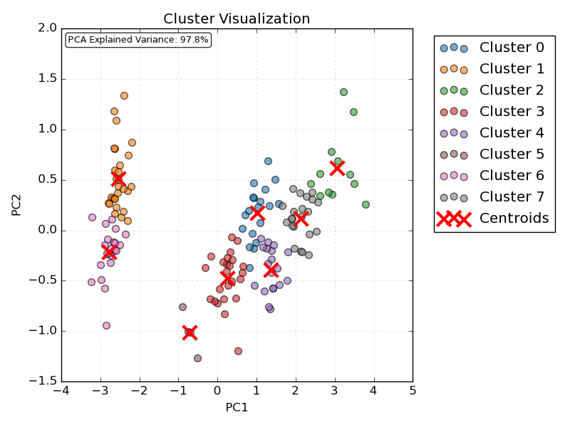
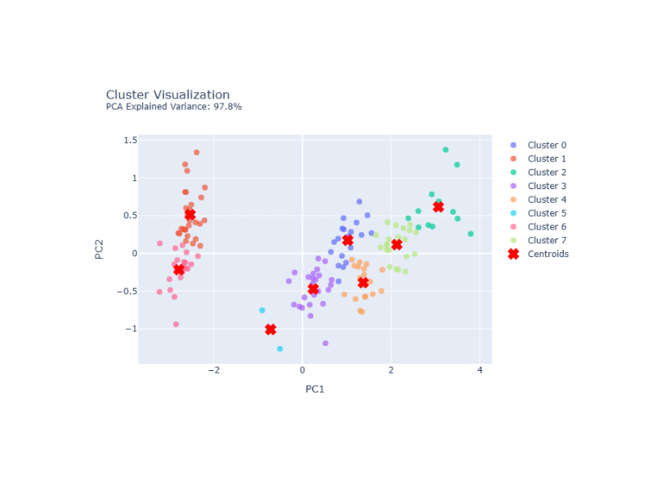

*****************************
Plot Clusters (Matplotlib)
*****************************

The plot_clusters function creates a 2D scatter plot of clustering results.
For data with more than 2 features, dimensionality reduction is applied
automatically. Supports PCA (default), t-SNE, and UMAP (requires the optional
``umap`` extra: ``pip install data-science-utils[umap]``).

.. autofunction:: ds_utils.unsupervised.cluster_projection.plot_clusters

Example::

    from matplotlib import pyplot as plt
    from sklearn.cluster import KMeans
    from ds_utils.unsupervised.cluster_projection import plot_clusters

    estimator = KMeans(n_clusters=8, random_state=42)
    estimator.fit(X)

    plot_clusters(X, estimator.labels_, estimator.cluster_centers_)
    plt.show()

*****************************
Plot Clusters (Plotly)
*****************************

The plot_clusters_plotly function provides an interactive Plotly scatter plot
with hover information showing coordinates and cluster labels.

.. autofunction:: ds_utils.unsupervised.cluster_projection.plot_clusters_plotly

Example::

    from ds_utils.unsupervised.cluster_projection import plot_clusters_plotly

    fig = plot_clusters_plotly(X, estimator.labels_, estimator.cluster_centers_)
    fig.show()

