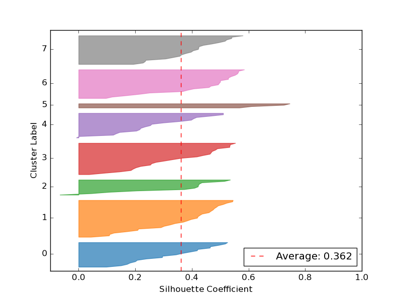

*******************
Silhouette Analysis
*******************

The plot_silhouette_analysis function plots the silhouette coefficient of every sample, grouped and sorted per cluster,
together with a dashed line at the average score. The coefficient compares how close a sample is to its own cluster with
how close it is to the nearest other cluster: values near 1 mean the sample is well matched to its cluster, values near 0
mean it lies on the boundary between two clusters, and negative values suggest it was assigned to the wrong cluster. It
complements the loss curve of plot_loss_vs_cluster_number when choosing the number of clusters, and it works with any
algorithm that produces cluster labels, not only K-Means.

.. autofunction:: ds_utils.unsupervised.silhouette.plot_silhouette_analysis

In the following example, we'll use the iris dataset from scikit-learn and create a simple K-Means algorithm with k=8 to
plot the silhouette coefficients of each cluster::

    from matplotlib import pyplot as plt
    from sklearn.cluster import KMeans
    from ds_utils.unsupervised.silhouette import plot_silhouette_analysis

    # Create and fit the K-Means model
    estimator = KMeans(n_clusters=8, random_state=42)
    estimator.fit(X)

    # Plot the silhouette analysis
    plot_silhouette_analysis(X, estimator.labels_)
    plt.show()

And the following image will be shown:

When reading the plot, look for clusters whose band lies mostly to the left of the dashed average line, clusters that are
much thicker or thinner than the others, and bars with negative values. As a rule of thumb (Kaufman and Rousseeuw), an
average silhouette above 0.7 indicates strong structure, 0.5 to 0.7 reasonable structure, 0.25 to 0.5 weak structure, and
below 0.25 no substantial structure.
