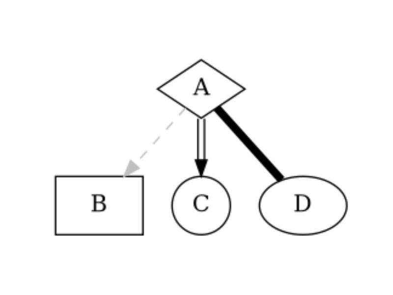
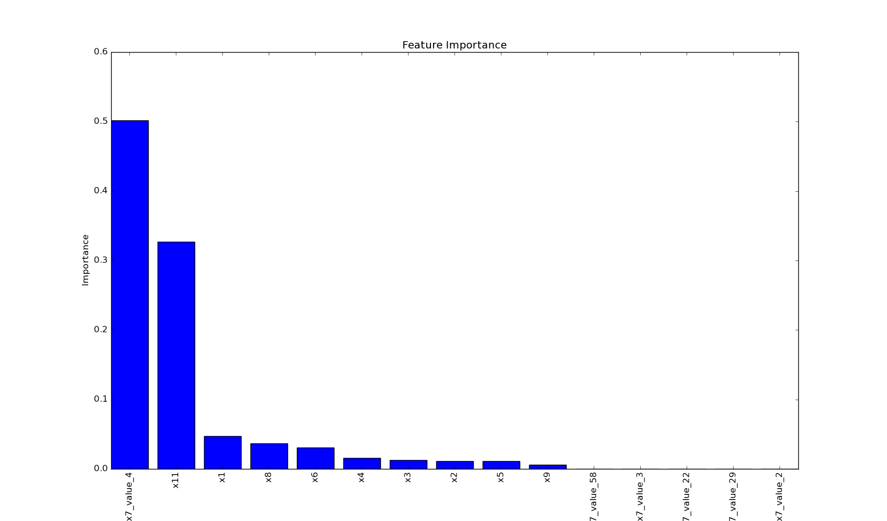

####################
XAI (Explainable AI)
####################
The xai module contains methods that help explain model decisions.

For this module to work properly, Graphviz must be installed. Use the following commands based on your operating system:

For Linux-based systems::

    sudo apt-get install graphviz

For Windows::

    choco install graphviz

For macOS::

    brew install graphviz

Using conda::

    conda install graphviz

For more information, see the `Graphviz download page <https://graphviz.gitlab.io/download>`_.

*************
Draw Dot Data
*************

The `draw_dot_data` function visualizes graph structures defined in DOT language. This is useful for creating custom graph visualizations, including decision trees, flowcharts, or any other graph-based representations.

.. autofunction:: ds_utils.xai.draw_dot_data

Code Example
============
Let's create a simple diagram and plot it:

.. code-block:: python

    import matplotlib.pyplot as plt
    from ds_utils.xai import draw_dot_data

    dot_data = """
    digraph D {
        A [shape=diamond]
        B [shape=box]
        C [shape=circle]

        A -> B [style=dashed, color=grey]
        A -> C [color="black:invis:black"]
        A -> D [penwidth=5, arrowhead=none]
    }
    """

    draw_dot_data(dot_data)
    plt.show()

The following image will be displayed:

*************************
Plot Feature Importance
*************************

The `plot_features_importance` function visualizes the importance of different features in a machine learning model. This is crucial for understanding which features have the most significant impact on the model's predictions, aiding in feature selection and model interpretation.

.. autofunction:: ds_utils.xai.plot_features_importance

Code Example
============

.. highlight:: python

For this example, we'll use a dummy dataset. You can find the data in the resources directory of the package's tests folder.

Here's how to use the code:

.. code-block:: python

    import pandas as pd
    import matplotlib.pyplot as plt
    from sklearn.preprocessing import OneHotEncoder
    from sklearn.tree import DecisionTreeClassifier
    from ds_utils.xai import plot_features_importance

    # Load the dataset
    data_1M = pd.read_csv('path/to/dataset.csv')
    target = data_1M["x12"]
    categorical_features = ["x7", "x10"]

    # Perform one-hot encoding for categorical features
    for feature in categorical_features:
        enc = OneHotEncoder(sparse=False, handle_unknown="ignore")
        enc_out = enc.fit_transform(data_1M[[feature]])
        for i, category in enumerate(enc.categories_[0]):
            data_1M[f"{feature}_{category}"] = enc_out[:, i]

    # Prepare feature list
    features = [col for col in data_1M.columns if col not in ["x12", "x7", "x10"]]

    # Create and train the classifier
    clf = DecisionTreeClassifier(random_state=42)
    clf.fit(data_1M[features], target)

    # Plot feature importance
    plot_features_importance(features, clf.feature_importances_)
    plt.show()

In this example:

- `x12` is the target variable we're trying to predict.
- `x7` and `x10` are categorical features that we one-hot encode.
- The remaining columns (x1, x2, x3, etc.) are numerical features.
- After one-hot encoding, we create a list of all features, excluding the original categorical columns and the target variable.
- We then train a decision tree classifier and plot the importance of each feature.

The following image will be displayed:

